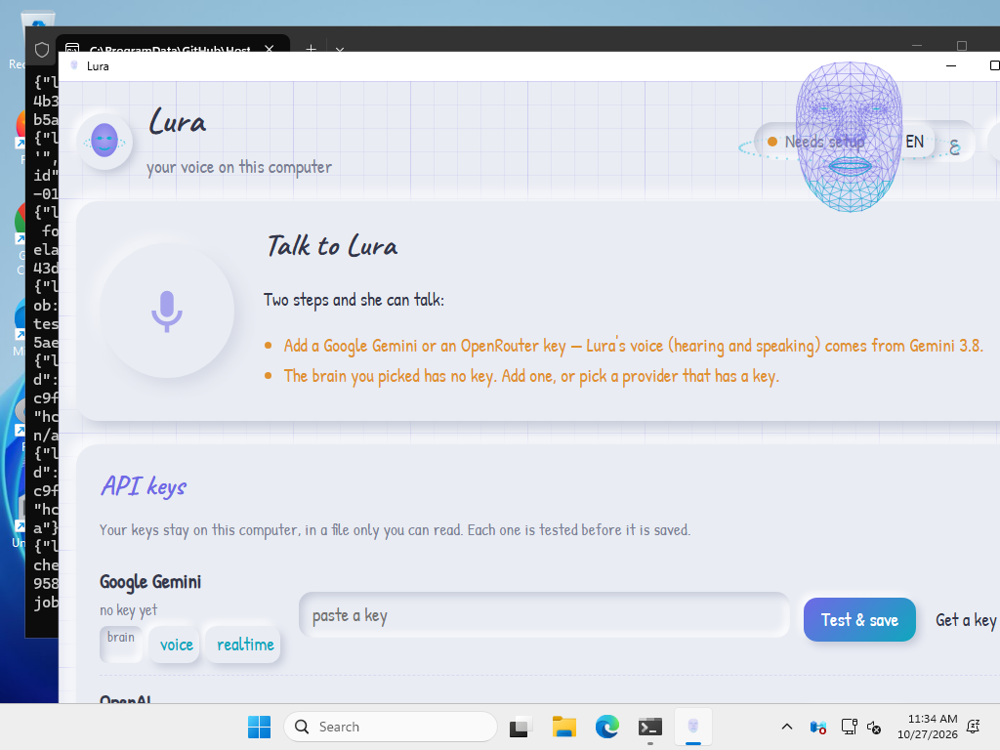
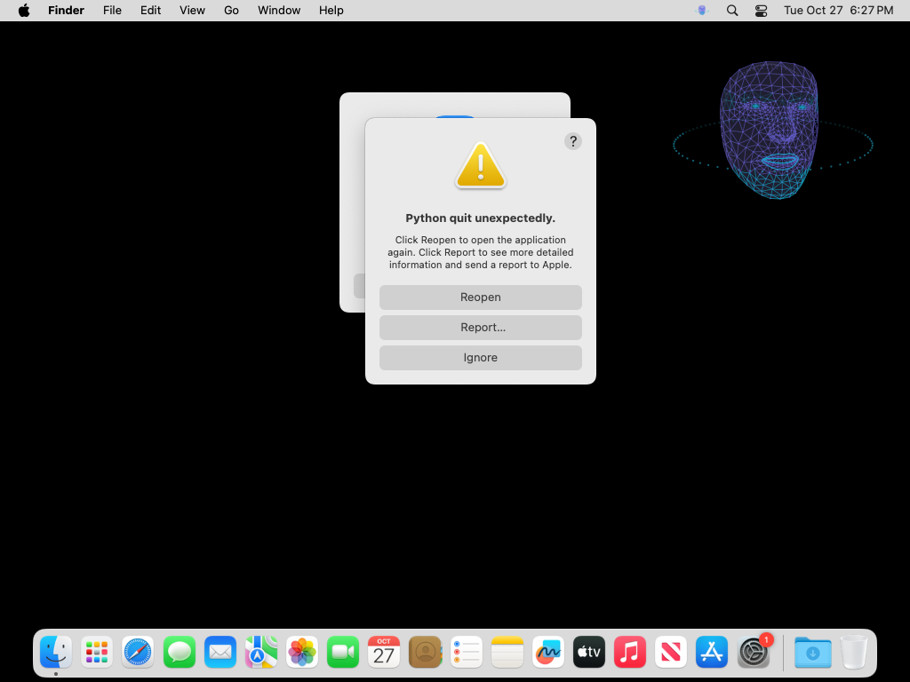
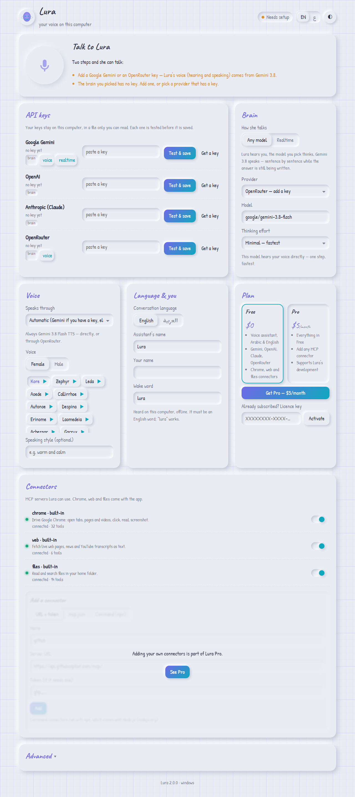
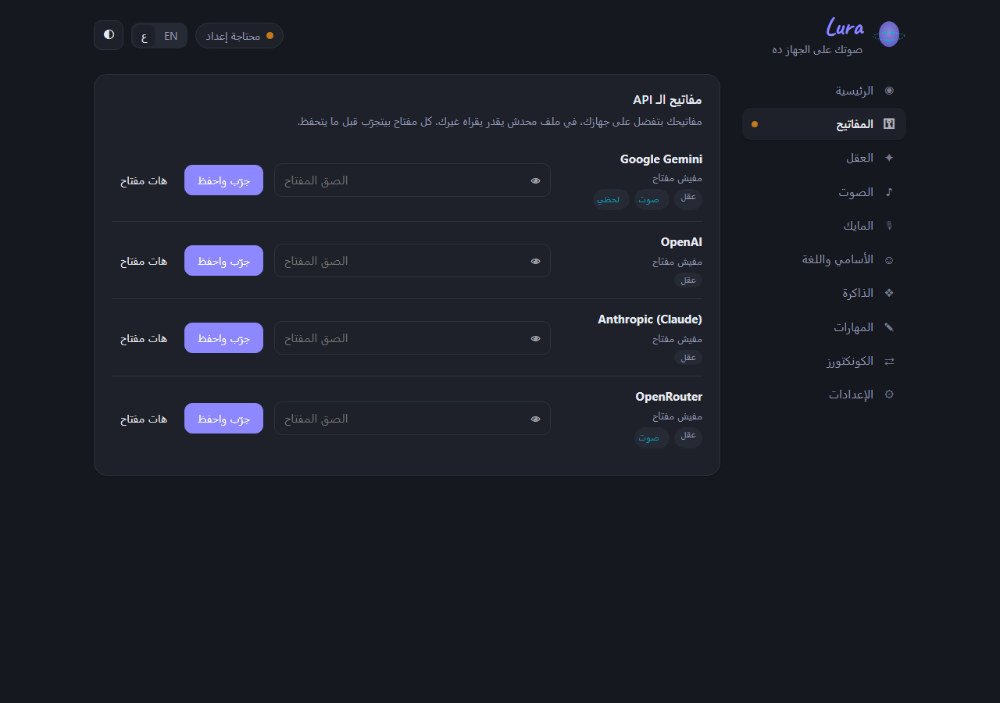

# Lura

**A voice-first desktop assistant for Linux, macOS and Windows.** Say *"Lura"*,
hear a chime, and talk. She answers out loud in **Arabic or English** and acts on
your computer: opens apps and web pages, drives Chrome, finds files, runs safe
commands, gives you a morning briefing, and uses any [MCP](https://modelcontextprotocol.io)
connector you add.

```
you:   "Lura"                                  ← heard offline, on your computer
lura:  *chime*
you:   "open YouTube in Chrome and play some lo-fi"
lura:  "Opening it now… done, it's playing."
```

- **Any brain:** Google Gemini, OpenAI, Anthropic (Claude) or OpenRouter. Pick
  the provider and model in the dashboard.
- **One voice:** Gemini 3.8 Flash TTS, either directly with a Gemini key or through
  OpenRouter. 30 voices, female or male.
- **Streaming speech:** Lura starts speaking the first sentence while the model
  is still writing the rest.
- **Realtime mode:** Gemini Live, a full-duplex audio line for the fastest replies.
- **Connectors:** Chrome DevTools, live web pages and your files are built in.
  Add any other MCP server by URL + token or by pasting its `mcp.json`.
- **The face:** an animated hologram floats top-right on every monitor while she
  listens, thinks and speaks.
- **Memory:** every conversation is kept on your computer; each new one starts
  from what she knows about you, a running summary and the recent turns.
- **Skills:** add Agent Skills (`SKILL.md`) and use them with any model.
- **Live captions:** what you say is written under the face while you speak.
- **Dashboard:** a calm local page with tabs for keys, brain, voice, microphone,
  memory, skills and connectors, in Arabic or English.

## Screenshots

These come from the release pipeline itself: each build is installed and run on
a clean machine and photographed (`docs/screenshots/`).

| Windows: the face over your apps, and the dashboard | macOS: the face and the menu-bar icon |
|---|---|
|  |  |

| Dashboard: English, light | Dashboard: Arabic, dark |
|---|---|
|  |  |

## Install

| Platform | How |
|---|---|
| **Ubuntu / Debian** | Download `lura_<version>_amd64.deb` from [Releases](https://github.com/mohamedjs/lura/releases), then `sudo apt install ./lura_<version>_amd64.deb` |
| **macOS** | `brew tap mohamedjs/lura https://github.com/mohamedjs/lura && brew install --cask lura`, or the zip from [Releases](https://github.com/mohamedjs/lura/releases) (see below) |
| **Windows** | Run `Lura-Setup-<version>.exe` from [Releases](https://github.com/mohamedjs/lura/releases) |
| **Other Linux** | Unpack `lura-<version>-linux-x86_64.tar.gz` and run `lura/LuraApp` |
| **From source** | `./install.sh` (Linux), or `pip install -e ".[all]"` then `lura` |

### Opening Lura on a Mac

Lura is not notarised by Apple yet (that needs a paid developer ID), so a
downloaded copy is stopped the first time with **“Lura” Not Opened — Apple could
not verify “Lura” is free of malware**. Click **Done** (not *Move to Trash*), then:

- **Homebrew** (easiest): the two commands above install Lura in Applications and
  clear the warning, so it simply opens. Update later with
  `brew upgrade --cask --greedy lura`.
- **Downloaded zip**: unzip, drag Lura into Applications, open it once, then open
  **System Settings → Privacy & Security**, scroll down and click **Open Anyway**
  next to “Lura”, and confirm with your password or Touch ID. Or, in Terminal:
  `xattr -dr com.apple.quarantine /Applications/Lura.app`
- The first time she listens, allow the **microphone**. Lura lives in the menu
  bar (top right), not in the Dock. The settings window: double-click the face,
  the menu-bar icon → Open dashboard, or `/Applications/Lura.app/Contents/MacOS/lura dashboard`.

Install **Node.js** too ([nodejs.org](https://nodejs.org)). It provides `npx`,
which runs the built-in Chrome, web and files connectors. Everything else works
without it.

On first start Lura opens the dashboard in your browser. Add a key and you are done.

## Keys: what you need

Lura is voice-first, and her hearing and speaking come from Gemini 3.8. So you need:

1. **One voice key: Google Gemini or OpenRouter.** This also covers the brain.
2. *Optionally* an **OpenAI** or **Anthropic** key, to use GPT or Claude as the brain.
   Neither speaks in Lura's pipeline, so they still need a voice key alongside.

| You have | Brain | Hearing | Voice |
|---|---|---|---|
| Gemini | Gemini 3.8 Flash (hears audio directly) | — | Gemini 3.8 TTS |
| OpenRouter | any model, default `google/gemini-3.8-flash` | direct for Gemini models, else transcribed | Gemini 3.8 TTS via OpenRouter |
| Anthropic + Gemini/OpenRouter | Claude | Gemini 3.8 Flash transcribes | Gemini 3.8 TTS |
| OpenAI + Gemini/OpenRouter | GPT | Gemini 3.8 Flash transcribes | Gemini 3.8 TTS |
| Anthropic or OpenAI only | — | — | ✗ add a voice key |

Keys are tested before they are saved. They live in a file only you can read
(`keys.json`, mode 0600) and are never sent anywhere except their own provider.
Environment variables override the file: `GEMINI_API_KEY`, `OPENAI_API_KEY`,
`ANTHROPIC_API_KEY`, `OPENROUTER_API_KEY`.

## Open source

Lura is free and open source under the [MIT licence](LICENSE). Nothing is
locked: every feature, including your own connectors and skills, is free. You
bring your own AI keys and pay the provider directly.

Contributions are welcome; see [CONTRIBUTING.md](CONTRIBUTING.md). The
maintainer reviews and approves every pull request.

## Command line

```
lura                    run the assistant (what the installers start at login)
lura dashboard          open the dashboard
lura say                talk now, without the wake word
lura briefing           the morning briefing, now
lura selftest           check microphone, speaker, keys, models and voice
lura login --provider gemini|openai|anthropic|openrouter
lura config [name] [value]
lura models [provider] [search]
lura mcp [list|add-url|import|remove|on|off|path]
lura autostart on|off
```

## Where things live

| | Linux | macOS | Windows |
|---|---|---|---|
| Settings, keys, connectors | `~/.config/lura/` | `~/Library/Application Support/Lura/` | `%APPDATA%\Lura\` |
| Wake model, log | `~/.local/share/lura/` | `…/Lura/data/` | `%LOCALAPPDATA%\Lura\` |

`mcp.json` uses the same format as every other MCP client, so you can paste a
server's README snippet straight in.

## Safety

- Lura refuses to delete or overwrite data: `rm`, `del`, `Remove-Item`, `format`,
  `dd`, `sudo`, redirects to disks, and command substitution are blocked **in code**,
  not merely discouraged in a prompt (`tests/test_command_guard.py`).
- The wake word runs offline. Nothing is sent anywhere until you say it.
- The dashboard listens only on `127.0.0.1` and requires a per-run token.

## For developers

- **[docs/ARCHITECTURE.md](docs/ARCHITECTURE.md)**: the modular monolith, its modules and layers
- **[docs/PROVIDERS.md](docs/PROVIDERS.md)**: what each provider can and cannot do, and why the pipeline looks like this
- **[docs/RELEASING.md](docs/RELEASING.md)**: building the .deb / .app / .exe, Homebrew, Lemon Squeezy
- **[AGENTS.md](AGENTS.md)**: hard-won facts; read before changing code
- **[USAGE.md](USAGE.md)**: day-to-day guide

```bash
pip install -e ".[all]"
python tests/run_all.py            # architecture, guard, domain, integration, dashboard
python -m lura.modules.overlay     # renders every face state headlessly
```

Fonts: Caveat, Patrick Hand and Marhey, under the SIL Open Font License
(`src/lura/modules/dashboard/static/fonts/OFL.txt`).
