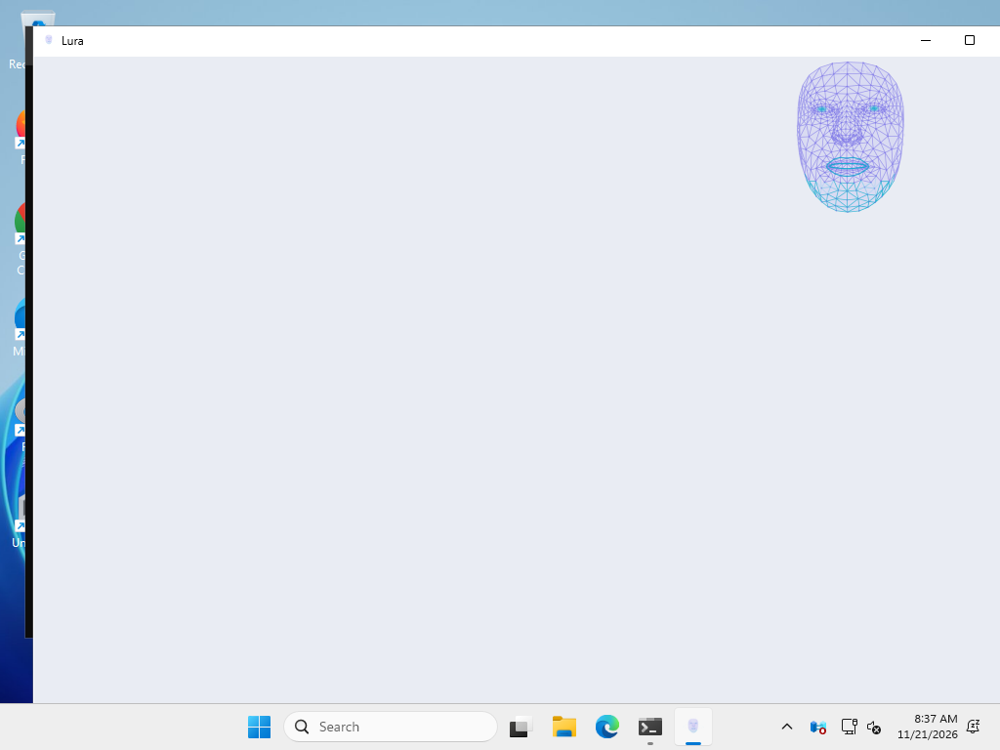
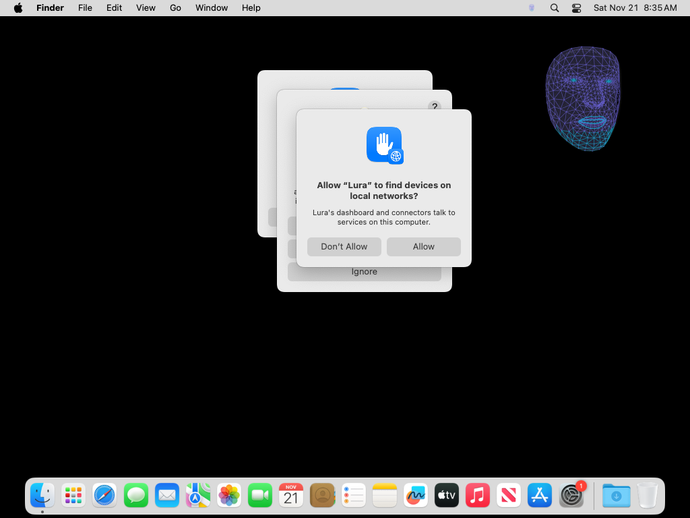
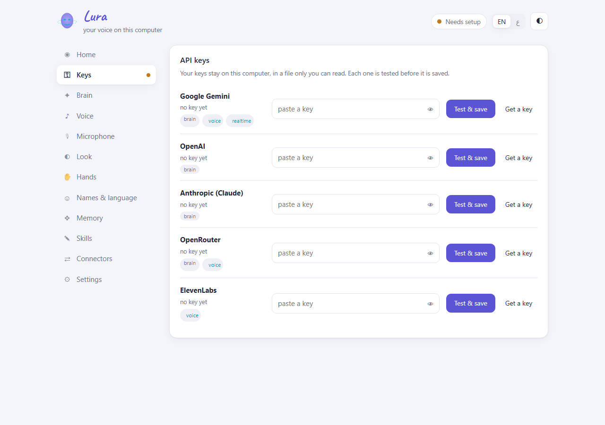
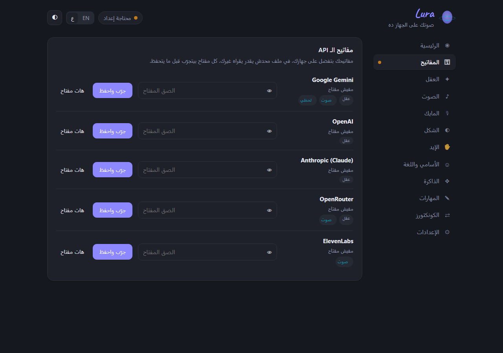

# Lura

**A voice-first desktop assistant for Linux, macOS and Windows.** Say *"Lura"*,
hear a chime, and talk. She answers out loud in **Arabic or English** and acts on
your computer: opens apps and web pages, drives Chrome, finds files, runs safe
commands, gives you a morning briefing, and uses any [MCP](https://modelcontextprotocol.io)
connector you add.

```
you:   "Lura"                                  ← heard offline, on your computer
lura:  *chime*
you:   "open YouTube in Chrome and play some lo-fi"
lura:  "Opening it now… done, it's playing."
```

- **Any brain:** Google Gemini, OpenAI, Anthropic (Claude) or OpenRouter. Pick
  the provider and model in the dashboard.
- **One voice:** Gemini 3.8 Flash TTS, either directly with a Gemini key or through
  OpenRouter. 30 voices, female or male.
- **Streaming speech:** Lura starts speaking the first sentence while the model
  is still writing the rest.
- **Realtime mode:** Gemini Live, a full-duplex audio line for the fastest replies.
- **Connectors:** Chrome DevTools, live web pages and your files are built in.
  Add any other MCP server by URL + token or by pasting its `mcp.json`.
- **The face:** an animated hologram floats top-right on every monitor while she
  listens, thinks and speaks. Pick its style (face, orb, bust with hands, ring),
  colours (five themes or your own) and size (60–200 %) in the dashboard's Look tab.
- **Memory:** every conversation is kept on your computer; each new one starts
  from what she knows about you, a running summary and the recent turns.
- **Skills:** add Agent Skills (`SKILL.md`) and use them with any model.
- **Live captions:** what you say is written under the face while you speak.
- **Dashboard:** a calm local page with tabs for keys, brain, voice, microphone,
  memory, skills and connectors, in Arabic or English.

## Screenshots

These come from the release pipeline itself: each build is installed and run on
a clean machine and photographed (`docs/screenshots/`).

| Windows: the face over your apps, and the dashboard | macOS: the face and the menu-bar icon |
|---|---|
|  |  |

| Dashboard: English, light | Dashboard: Arabic, dark |
|---|---|
|  |  |

## Install

| Platform | How |
|---|---|
| **Ubuntu / Debian** | Download `lura_<version>_amd64.deb` from [Releases](https://github.com/mohamedjs/lura/releases), then `sudo apt install ./lura_<version>_amd64.deb` |
| **macOS** | `brew tap mohamedjs/lura https://github.com/mohamedjs/lura && brew install --cask lura`, or the zip from [Releases](https://github.com/mohamedjs/lura/releases) (see below) |
| **Windows** | Run `Lura-Setup-<version>.exe` from [Releases](https://github.com/mohamedjs/lura/releases) |
| **Other Linux** | Unpack `lura-<version>-linux-x86_64.tar.gz` and run `lura/LuraApp` |
| **From source** | `./install.sh` (Linux), or `pip install -e ".[all]"` then `lura` |

Lura **updates herself**: when a new version is out, the dashboard shows it with an
**Update now** button. She downloads the right file, checks it against the release's
checksums, installs it and opens again (from 2.2.1 on).

### Opening Lura on a Mac

Lura is not notarised by Apple yet (that needs a paid developer ID), so a
downloaded copy is stopped the first time with **“Lura” Not Opened — Apple could
not verify “Lura” is free of malware**. Click **Done** (not *Move to Trash*), then:

- **Homebrew** (easiest): the two commands above install Lura in Applications and
  clear the warning, so it simply opens. Update later with
  `brew upgrade --cask --greedy lura`.
- **Downloaded zip**: unzip, drag Lura into Applications, open it once, then open
  **System Settings → Privacy & Security**, scroll down and click **Open Anyway**
  next to “Lura”, and confirm with your password or Touch ID. Or, in Terminal:
  `xattr -dr com.apple.quarantine /Applications/Lura.app`
- The first time she listens, allow the **microphone**. Lura lives in the menu
  bar (top right), not in the Dock. The settings window: double-click the face,
  the menu-bar icon → Open dashboard, or `/Applications/Lura.app/Contents/MacOS/lura dashboard`.

Lura downloads her own **Node.js** runtime into the data folder (`<data>/node`) on
first start, so the built-in Chrome, web and files connectors (and any `npx`
connector you add) work without installing Node.js yourself.

### Lura Air gestures

Hold your hand close to the camera:

- **Move:** point one finger; the mouse follows your index knuckle. Slow = small precise
  steps, fast = across the screen. Close the finger to lift the mouse.
- **Click:** finger gun — point with the thumb up, tap the thumb down onto the middle finger
  and up again (twice = double-click). Touching thumb and index tip clicks too.
- **Drag / draw:** keep the thumb down (about ⅓ s), move, thumb up to let go.
- **Right-click:** two fingers (V) with the same thumb tap.
- **Scroll:** flick the pointing finger up or down like a phone; the page glides and slows
  down by itself, a fist stops it. Two fingers (V) moved up/down scroll slowly.
- **Workspaces:** sweep the edge of your hand left or right. **Yes / no:** thumbs up / down.

The thumb-tap click can be switched off in the **Hands** tab (`air_thumb_click`).

### Lura Air on macOS

Turning on **Lura Air** (hand control) on a Mac asks for two privacy permissions:
**Camera** and **Accessibility** (to move the mouse and windows). The dashboard's
**Hands** tab shows both and has buttons that open the right System Settings page.
Switching Spaces moves one Space at a time with `Control+←` / `Control+→` (make sure
Mission Control's Space shortcuts are enabled in Keyboard Shortcuts); screen
brightness and media keys are not supported on macOS yet. Because Lura is signed ad
hoc, macOS may ask for Accessibility again after an update — remove Lura from the
Accessibility list and add it back.

On first start Lura opens the dashboard in your browser. Add a key and you are done.

## Keys: what you need

Lura is voice-first, and her hearing and speaking come from Gemini 3.8. So you need:

1. **One voice key: Google Gemini or OpenRouter.** This also covers the brain.
2. *Optionally* an **OpenAI** or **Anthropic** key, to use GPT or Claude as the brain.
   Neither speaks in Lura's pipeline, so they still need a voice key alongside.

| You have | Brain | Hearing | Voice |
|---|---|---|---|
| Gemini | Gemini 3.8 Flash (hears audio directly) | — | Gemini 3.8 TTS |
| OpenRouter | any model, default `google/gemini-3.8-flash` | direct for Gemini models, else transcribed | Gemini 3.8 TTS via OpenRouter |
| Anthropic + Gemini/OpenRouter | Claude | Gemini 3.8 Flash transcribes | Gemini 3.8 TTS |
| OpenAI + Gemini/OpenRouter | GPT | Gemini 3.8 Flash transcribes | Gemini 3.8 TTS |
| Anthropic or OpenAI only | — | — | ✗ add a voice key |

Keys are tested before they are saved. They live in a file only you can read
(`keys.json`, mode 0600) and are never sent anywhere except their own provider.
Environment variables override the file: `GEMINI_API_KEY`, `OPENAI_API_KEY`,
`ANTHROPIC_API_KEY`, `OPENROUTER_API_KEY`.

## Open source

Lura is free and open source under the [MIT licence](LICENSE). Nothing is
locked: every feature, including your own connectors and skills, is free. You
bring your own AI keys and pay the provider directly.

Contributions are welcome; see [CONTRIBUTING.md](CONTRIBUTING.md). The
maintainer reviews and approves every pull request.

## Command line

```
lura                    run the assistant (what the installers start at login)
lura dashboard          open the dashboard
lura say                talk now, without the wake word
lura briefing           the morning briefing, now
lura selftest           check microphone, speaker, keys, models and voice
lura login --provider gemini|openai|anthropic|openrouter
lura config [name] [value]
lura models [provider] [search]
lura mcp [list|add-url|import|remove|on|off|path|runtime]
lura autostart on|off
```

## Where things live

| | Linux | macOS | Windows |
|---|---|---|---|
| Settings, keys, connectors | `~/.config/lura/` | `~/Library/Application Support/Lura/` | `%APPDATA%\Lura\` |
| Wake model, `node/`, log | `~/.local/share/lura/` | `…/Lura/data/` | `%LOCALAPPDATA%\Lura\` |

**ElevenLabs voice.** Paste an ElevenLabs key under Keys and Lura hears with Scribe v2
and speaks with your account's voices (female or male, a separate choice for each) through
Flash v2.5, v4 Turbo, Multilingual v2 or v4. The key is only for the voice, never the brain (add it in the dashboard; `lura login` is
for brain keys). If ElevenLabs runs out of credit, a Gemini or OpenRouter key takes over
hearing and speaking. Unlike Gemini, Scribe also writes down a TV or video playing nearby.

**Offline voice.** When every online voice fails (free quota used up, no credit, no
network), Lura speaks with [Piper](https://github.com/rhasspy/piper) on your computer:
free, no key, no daily limit. One English voice (`en_US-lessac`) and one Arabic voice
(`ar_JO-kareem`, Modern Standard Arabic, male only), picked per sentence. Piper ships
inside the Linux and Windows builds; on macOS and source installs Lura downloads it
the first time she starts (macOS not tested yet). The two voices (~130 MB, their own dataset licences) are
downloaded from Hugging Face into `<data>/piper/`.

`mcp.json` uses the same format as every other MCP client, so you can paste a
server's README snippet straight in.

## Safety

- Lura refuses to delete or overwrite data: `rm`, `del`, `Remove-Item`, `format`,
  `dd`, `sudo`, redirects to disks, and command substitution are blocked **in code**,
  not merely discouraged in a prompt (`tests/test_command_guard.py`).
- The wake word runs offline. Nothing is sent anywhere until you say it.
- The dashboard listens only on `127.0.0.1` and requires a per-run token.

## For developers

- **[docs/ARCHITECTURE.md](docs/ARCHITECTURE.md)**: the modular monolith, its modules and layers
- **[docs/PROVIDERS.md](docs/PROVIDERS.md)**: what each provider can and cannot do, and why the pipeline looks like this
- **[docs/RELEASING.md](docs/RELEASING.md)**: building the .deb / .app / .exe, Homebrew, Lemon Squeezy
- **[AGENTS.md](AGENTS.md)**: hard-won facts; read before changing code
- **[USAGE.md](USAGE.md)**: day-to-day guide

```bash
pip install -e ".[all]"
python tests/run_all.py            # architecture, guard, domain, integration, dashboard
python -m lura.modules.overlay     # renders every face state headlessly
```

Fonts: Caveat, Patrick Hand and Marhey, under the SIL Open Font License
(`src/lura/modules/dashboard/static/fonts/OFL.txt`).
